# UrbanInspect

**Registro y seguimiento de incidencias urbanas — Práctica de Desarrollo de Aplicaciones Móviles (ESFOT)**

UrbanInspect es una aplicación para Android enfocada en reportar problemas de infraestructura urbana: baches, luminarias dañadas, señalización deteriorada, alcantarillas obstruidas y daños en parques. Permite registrar la ubicación, adjuntar evidencia fotográfica, consultar el clima y dar seguimiento a los casos.

El proyecto se realizó con **Ionic, Angular, TypeScript y Capacitor**. Para las pruebas utilicé **MockAPI** como servicio REST, **Cloudinary** para guardar fotografías y **Open-Meteo** para las condiciones meteorológicas. Los registros marcados para seguimiento y los formularios incompletos se conservan localmente en el dispositivo.

## 1. Capturas de la aplicación Android

Estas evidencias corresponden a la aplicación ejecutada en un teléfono Android. Los códigos `DEMO-...` son registros de prueba cargados previamente en MockAPI; los códigos `UI-...` corresponden a registros creados desde la aplicación.

### Instalación y registro

| Pantalla de inicio | Formulario de incidencia | Fotografía tomada desde Android |
|:---:|:---:|:---:|
|  | 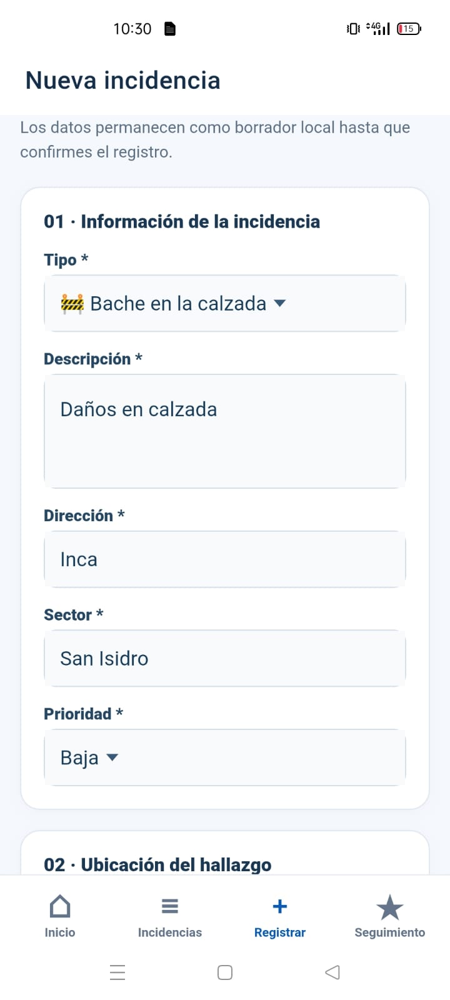 | 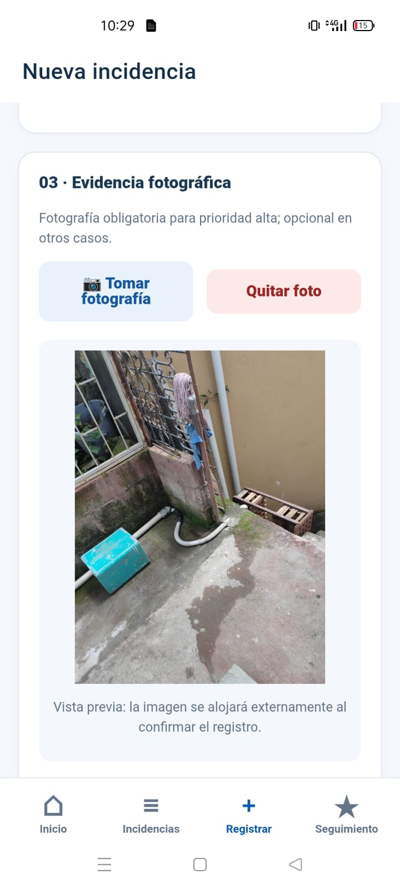 |

### Consulta meteorológica y registro remoto

| Condiciones meteorológicas | Confirmación de registro | Incidencia en listado |
|:---:|:---:|:---:|
| 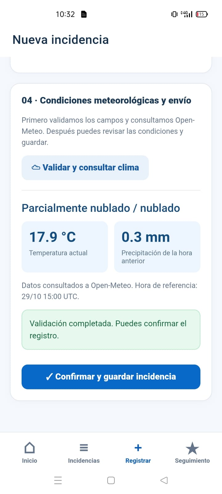 | 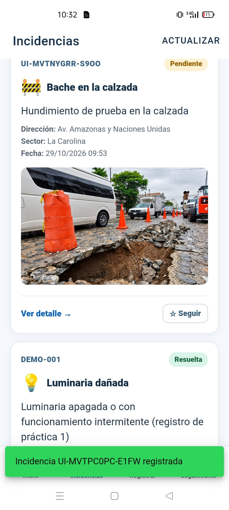 | 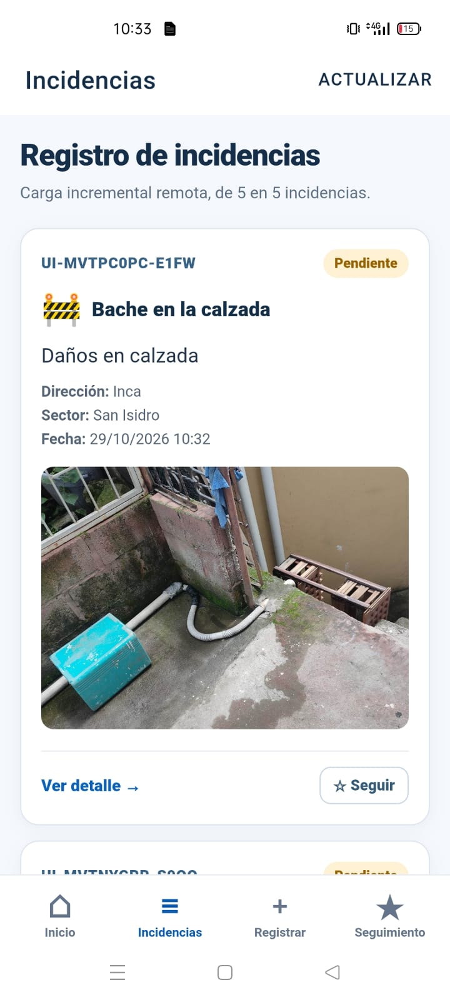 |

### Detalle, seguimiento y recuperación

| Actualización de estado | Seguimiento local | Borrador recuperable |
|:---:|:---:|:---:|
| 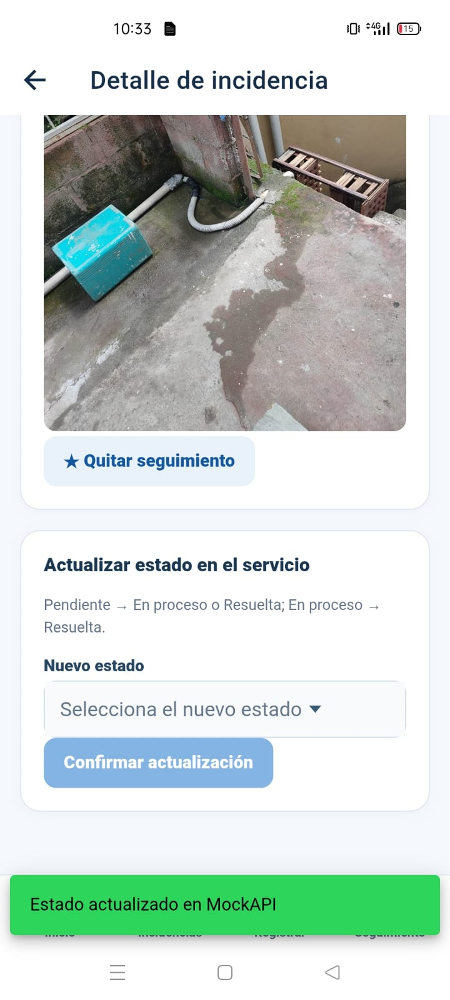 | 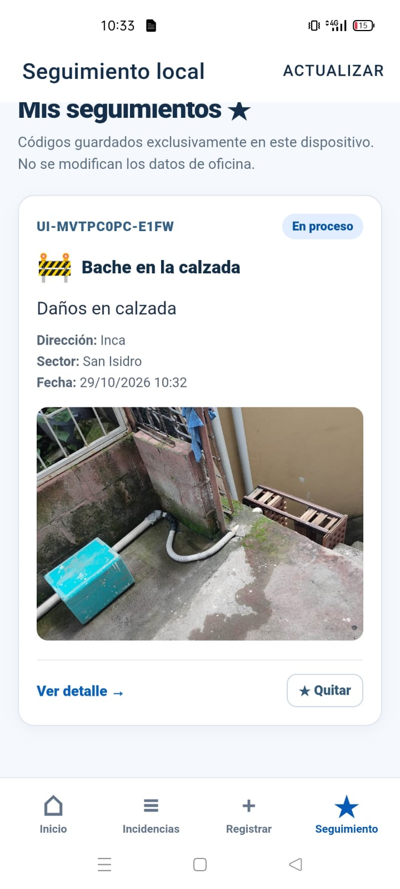 | 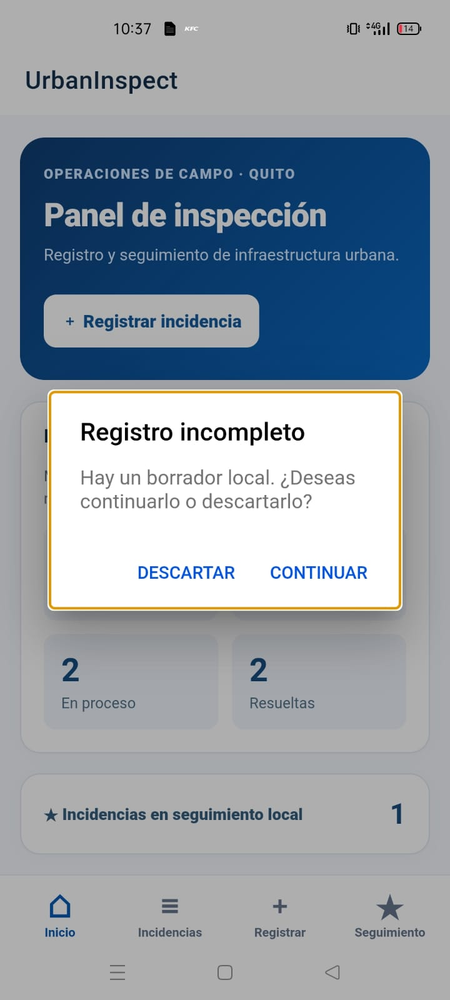 |

### Validaciones y evidencia en el listado

| Prioridad alta | Ubicación no ingresada | Imagen del registro |
|:---:|:---:|:---:|
| 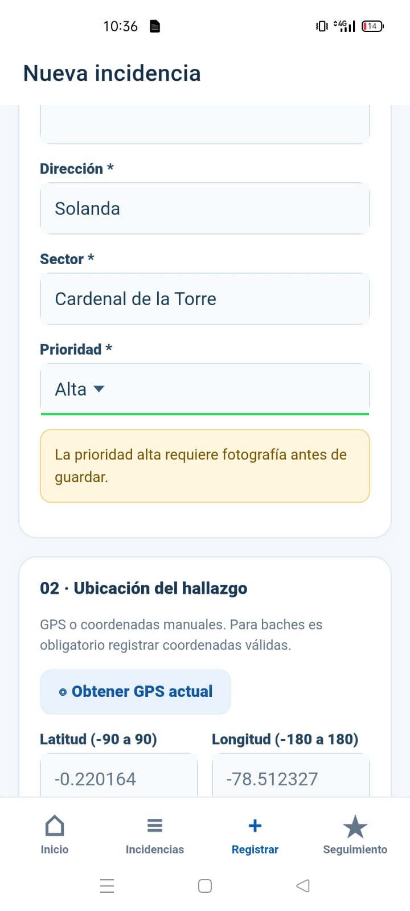 | 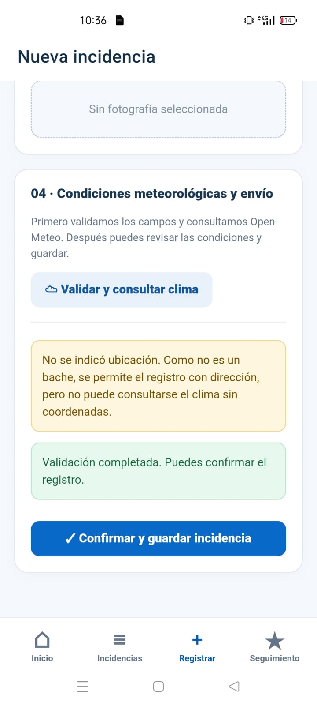 | 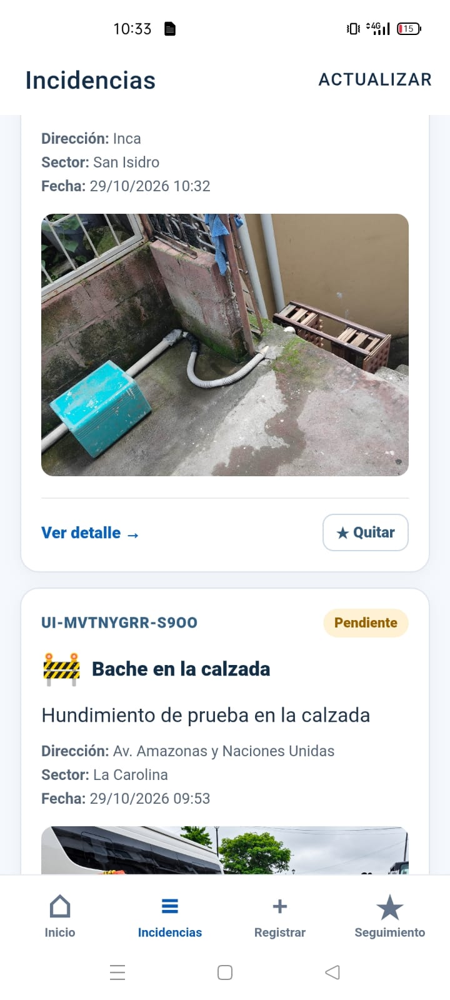 |

## 2. Funciones principales

- **Listado de incidencias:** consulta los datos del servidor de manera incremental, solicitando hasta cinco registros por página. Muestra tipo, descripción, dirección, sector, fecha, prioridad, estado y fotografía cuando existe.
- **Seguimiento local:** permite marcar y quitar incidencias; las marcas se almacenan en el teléfono, sin cambiar la información de MockAPI.
- **Registro de incidencias:** valida tipo, descripción, dirección, sector y prioridad. En prioridad alta exige una fotografía y para baches exige coordenadas válidas.
- **Cámara y fotografías:** en Android permite tomar una fotografía, revisarla y enviarla a Cloudinary. Se guarda la URL HTTPS en el registro remoto y la imagen puede consultarse después.
- **Ubicación:** obtiene coordenadas mediante GPS con permiso del usuario o permite escribirlas manualmente. Si no hay coordenadas y no se trata de un bache, puede registrarse el caso sin consulta meteorológica.
- **Clima:** consulta la temperatura, condición meteorológica y precipitación de la última hora a través de Open-Meteo. Si la precipitación supera 5 mm, presenta una advertencia sin bloquear automáticamente el registro.
- **Borradores:** guarda información incompleta localmente y ofrece las opciones **Continuar** y **Descartar** al recuperar el formulario.
- **Estados:** permite pasar de pendiente a en proceso o resuelta, y de en proceso a resuelta. Para resolver se necesita observación; una incidencia resuelta no puede retroceder a otro estado.

## 3. Herramientas y decisiones técnicas

| Tecnología | Uso en UrbanInspect |
|---|---|
| Ionic y Angular | Vistas, navegación, controles, formularios y eventos de la interfaz |
| TypeScript | Tipos de datos, validaciones, servicios y estados |
| Capacitor | Integración con Android y acceso a cámara, ubicación y almacenamiento |
| MockAPI | Operaciones REST de consulta, creación y actualización de incidencias |
| Cloudinary | Almacenamiento externo de imágenes y recuperación mediante URL |
| Open-Meteo | Condiciones meteorológicas para las coordenadas registradas |
| Capacitor Preferences | Seguimientos y datos del borrador en almacenamiento local |
| Capacitor Filesystem | Conservación local de la fotografía de un borrador |

Se utilizó un servicio REST de pruebas en lugar de implementar un servidor propio para concentrar la práctica en las funciones móviles, la comunicación HTTP y la persistencia local. **MockAPI no representa un sistema de producción con autenticación.**

## 4. Requisitos para ejecutar

- Node.js y npm compatibles con la versión de Angular del proyecto.
- Ionic CLI instalado.
- Android Studio, Android SDK y JDK configurados para generar el APK.
- Conexión a internet para MockAPI, Cloudinary y Open-Meteo.

### Ejecutar en el navegador

Abrir CMD en la carpeta descargada del repositorio:

```cmd
npm ci
npm install -g @ionic/cli
ionic serve
```

La aplicación se abre normalmente en `http://localhost:8100`. Las pruebas de GPS y cámara nativos deben hacerse en Android; en el navegador se puede seleccionar una fotografía del equipo.

### Configurar los servicios

En `src/app/config/config.ts` se encuentran los valores públicos de conexión:

```typescript
export const CONFIG = {
  mockApiBaseUrl: 'https://TU_PROYECTO.mockapi.io/api/v1',
  cloudinaryCloudName: 'TU_CLOUD_NAME',
  cloudinaryUnsignedPreset: 'urbaninspect_unsigned',
  pageSize: 5,
} as const;
```

El ejemplo anterior usa marcadores de posición. Hay que reemplazarlos por los valores del proyecto de prueba; no se añade `/incidencias` al final de `mockApiBaseUrl`, porque el servicio lo incorpora.

**MockAPI:** crear el recurso `incidencias` con los campos `codigo`, `tipo`, `descripcion`, `direccion`, `sector`, `prioridad`, `fecha`, `estado`, `fotoUrl`, `latitud`, `longitud`, `observacion` y `actualizadoEn`. El campo `id` lo genera el servicio. Para la paginación se utilizan `page` y `limit`.

**Cloudinary:** configurar un preset `urbaninspect_unsigned` de tipo *Unsigned* para las fotografías de la práctica. No colocar API Secret ni credenciales privadas en el frontend o el repositorio. **Open-Meteo** se consulta sin una clave privada en este proyecto.

### Datos de prueba y comprobación

Los scripts disponibles en `scripts/` permiten insertar 18 incidencias y comprobar la respuesta del servicio:

```cmd
scripts\INSERTAR_18_DATOS.cmd
scripts\COMPROBAR_API.cmd
```

El primer comando agrega registros y **no debe ejecutarse varias veces** sobre el mismo recurso si no se desean duplicados. Los datos `DEMO-...` son ficticios y se usan para probar estados, tipos, prioridades y paginación. No están escritos directamente en las pantallas de Angular.

## 5. Ejecutar en Android

Desde la raíz del proyecto:

```cmd
ionic build
npx cap sync android
npx cap open android
```

Otra opción es crear un APK de depuración desde CMD:

```cmd
cd android
gradlew.bat assembleDebug
```

Archivo generado:

```text
android/app/build/outputs/apk/debug/app-debug.apk
```

El nombre del APK puede cambiarse al copiar el archivo para la entrega; eso no modifica el identificador de la aplicación. Un APK de depuración sirve para demostración o pruebas, no equivale a una versión de distribución publicada.

## 6. Organización del proyecto

```text
src/
  app/
    app.component.ts           Inicio general y detección de borrador
    app.routes.ts              Rutas de navegación
    config/config.ts           Direcciones de los servicios
    models/incidencia.ts       Interfaces y tipos de datos
    pages/
      inicio.page.ts           Panel principal
      incidencias.page.ts      Listado y carga incremental
      nuevo.page.ts            Formulario, cámara, GPS, clima y registro
      detalle.page.ts          Detalle y actualización de estados
      seguimiento.page.ts      Casos marcados localmente
    services/
      incidencias.service.ts   Solicitudes HTTP a MockAPI
      fotos.service.ts         Subida de imágenes a Cloudinary
      clima.service.ts         Consulta a Open-Meteo
      seguimiento.service.ts   Códigos guardados en Preferences
      borrador.service.ts      Borrador y foto local
    shared/
      navegacion.component.ts  Barra inferior
      tarjeta-incidencia.component.ts  Tarjetas de incidencias
android/                     Proyecto Android/Gradle
assets/                      Recursos fuente del icono y splash
scripts/                     Herramientas de verificación y datos de práctica
docs/capturas/               Evidencias de prueba
```

Las rutas de la interfaz son `/inicio`, `/incidencias`, `/nuevo`, `/seguimiento` y `/detalle/:id`.

## 7. Verificación desde computadora

Las capturas de esta sección son complementarias. La evidencia principal está tomada en Android.

| Datos recibidos desde MockAPI | Comprobación del registro en la web |
|:---:|:---:|
| 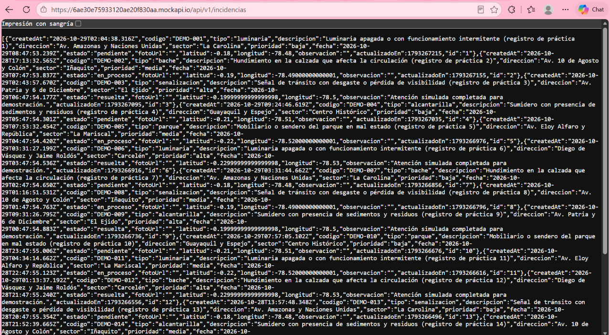 | 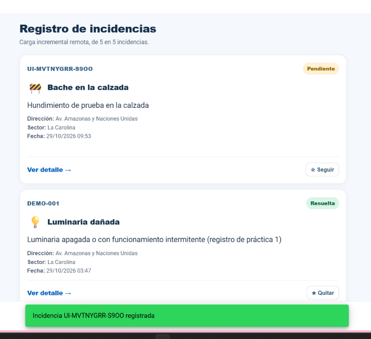 |

La carga de cinco en cinco puede revisarse en la pestaña de red del navegador (`F12` → `Network` → `Fetch/XHR`) o usando `scripts\COMPROBAR_API.cmd`. Las consultas utilizan `page` y `limit`; los resultados no están precargados en una lista fija dentro del proyecto.

## 8. Alcance y observaciones

Este es un proyecto académico de demostración. El servicio de datos es MockAPI y las fotografías se alojan en Cloudinary mediante un preset de práctica. Para un sistema real harían falta autenticación, permisos por usuario, control de acceso al servicio y validaciones del lado del servidor. Los registros demostrativos no deben interpretarse como reportes oficiales.

Las funciones que dependen de permisos del sistema operativo —especialmente cámara y GPS— se prueban en Android. La consulta meteorológica depende de disponibilidad de internet y de los datos que devuelva Open-Meteo. La precipitación mostrada corresponde al período horario consultado y no necesariamente a la lluvia instantánea.
