# UrbanInspect

**Firebase Hosting + inicio de sesión · Reportes Quito**

**Proyecto publicado:** [urbaninspect-deploy.web.app](https://urbaninspect-deploy.web.app)

**Rama de entrega:** [firebase-hosting-login](https://github.com/Dilanbkr7/UrbanInspect/tree/firebase-hosting-login)

UrbanInspect permite registrar problemas de infraestructura urbana, adjuntar fotografías, indicar la ubicación y consultar el estado de cada reporte. La aplicación está desarrollada con Ionic, Angular y Capacitor; funciona en el navegador y conserva el proyecto Android de la primera prueba.

## Firebase Hosting + inicio de sesión

La versión web está publicada en el proyecto propio `urbaninspect-deploy`. Para entrar, se puede crear una cuenta desde **Crea una cuenta** y después iniciar sesión con ese correo y contraseña.

- Registro con nombre, correo y confirmación de contraseña.
- Inicio de sesión mediante Firebase Authentication.
- Sesión conservada al recargar la página.
- Recuperación de contraseña por correo.
- Pantalla **Mi cuenta** con los datos del usuario y cierre de sesión.
- Acceso protegido al panel, listado, registro, seguimiento y detalle de incidencias.
- Regreso a la pantalla solicitada después de iniciar sesión.
- Borradores y seguimientos locales separados por usuario.

Las pantallas de acceso se adaptan a celular y computadora. Las contraseñas se gestionan con Firebase Authentication; la aplicación no las guarda en su código ni en las preferencias locales.

El repositorio [login-firebase](https://github.com/Dilanbkr7/login-firebase) se utilizó como referencia para el acceso con correo y contraseña. La versión publicada y el APK utilizan el mismo proyecto Firebase, `urbaninspect-deploy`: una cuenta creada en cualquiera de las dos versiones sirve para ingresar en ambas.

## Capturas del APK en Android

Las siguientes capturas se tomaron en un dispositivo Android el 5 de noviembre de 2026. Muestran la apertura del APK, el registro de la cuenta, el acceso y la consulta de reportes con la sesión iniciada.

### Apertura e inicio de sesión

| Pantalla de apertura | Inicio de sesión | Datos de acceso |
|:---:|:---:|:---:|
|  |  | 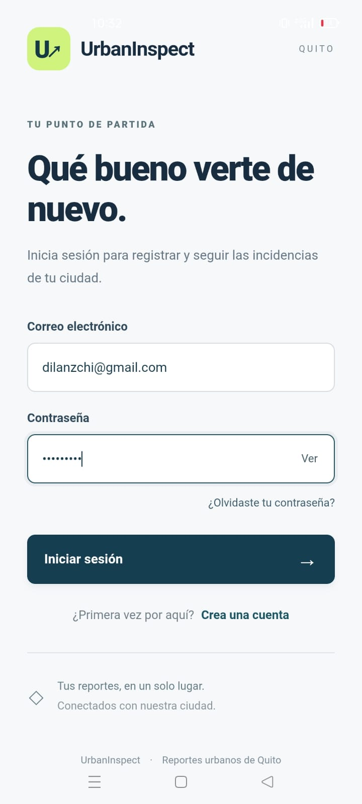 |

### Registro y acceso al panel

| Crear una cuenta | Formulario completado | Panel con sesión iniciada |
|:---:|:---:|:---:|
| 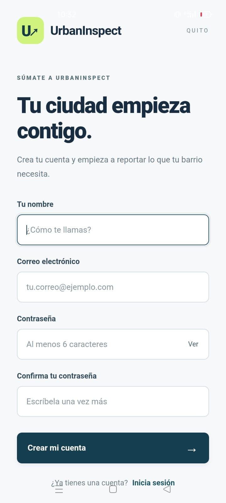 | 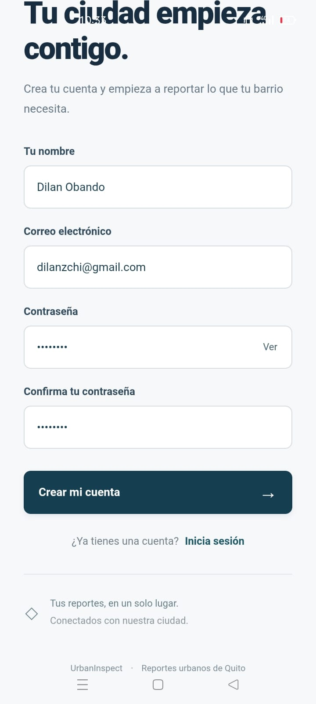 | 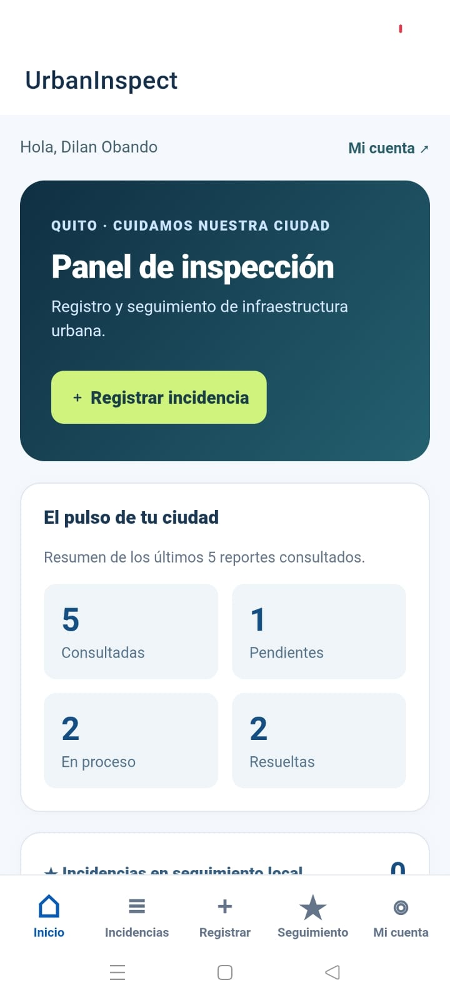 |

### Cuenta y consulta de incidencias

| Mi cuenta | Reportes y evidencia fotográfica |
|:---:|:---:|
| 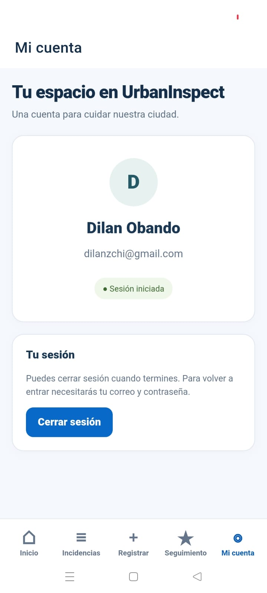 | 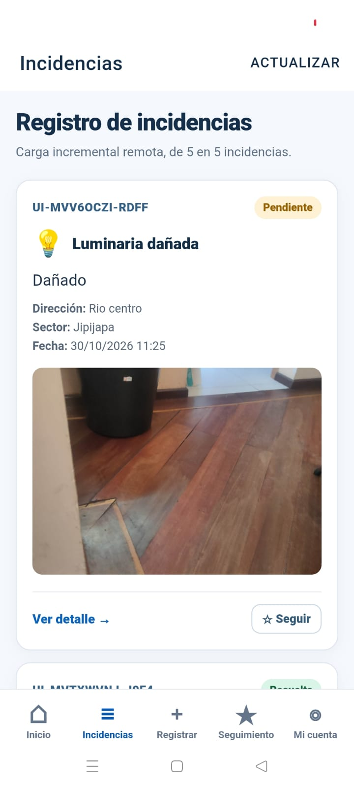 |

## Capturas de la versión publicada

Estas capturas se tomaron desde la URL pública el 5 de noviembre de 2026. Para comprobar el registro y el acceso se utilizó una cuenta temporal de prueba, eliminada al terminar. El listado muestra datos recibidos del servicio de incidencias.

### Acceso desde computadora y celular

| Inicio de sesión web | Inicio de sesión móvil |
|:---:|:---:|
| 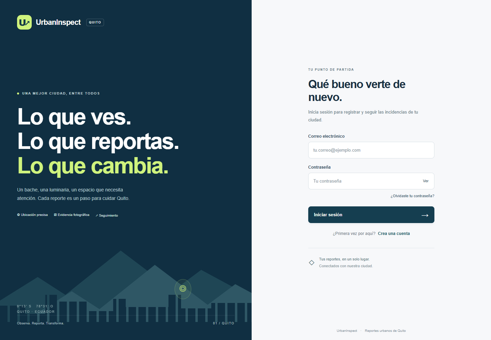 | 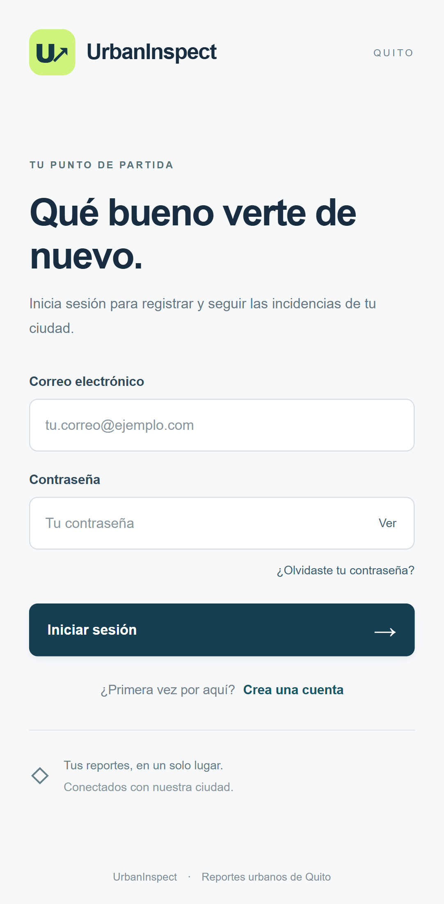 |

### Registro y recuperación

| Crear una cuenta | Recuperar contraseña |
|:---:|:---:|
| 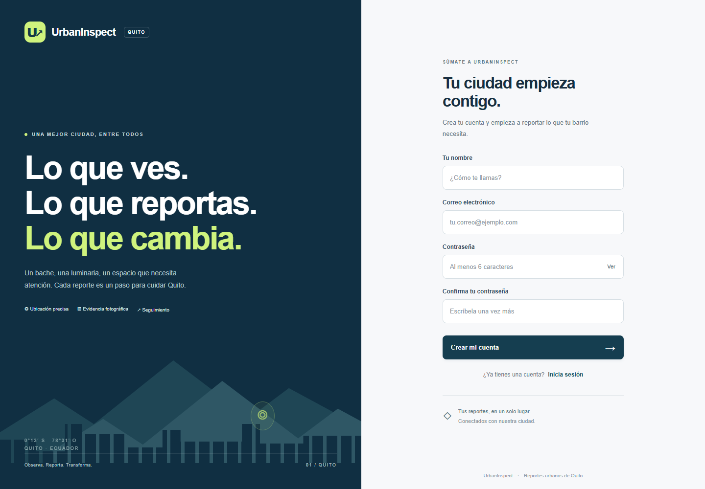 | 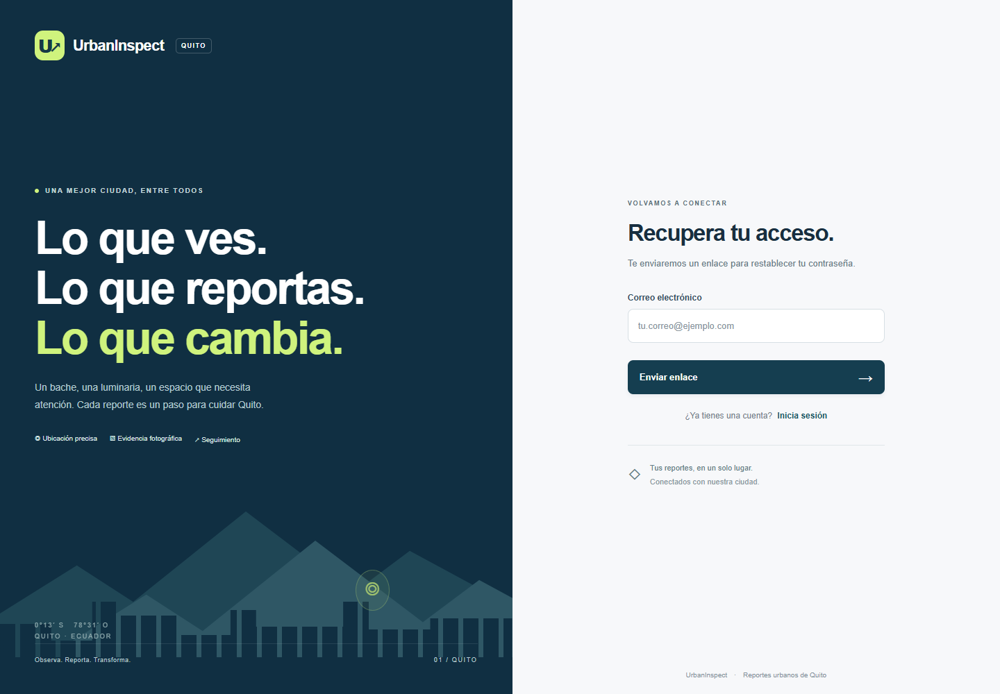 |

### Sesión iniciada y reportes

| Panel de inspección | Listado de incidencias |
|:---:|:---:|
| 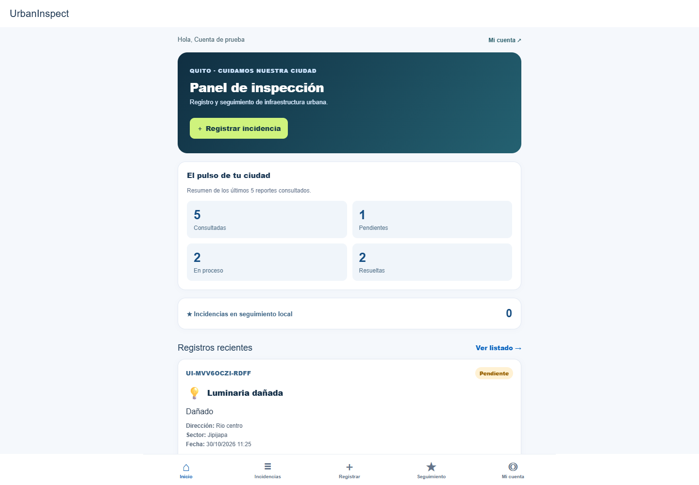 | 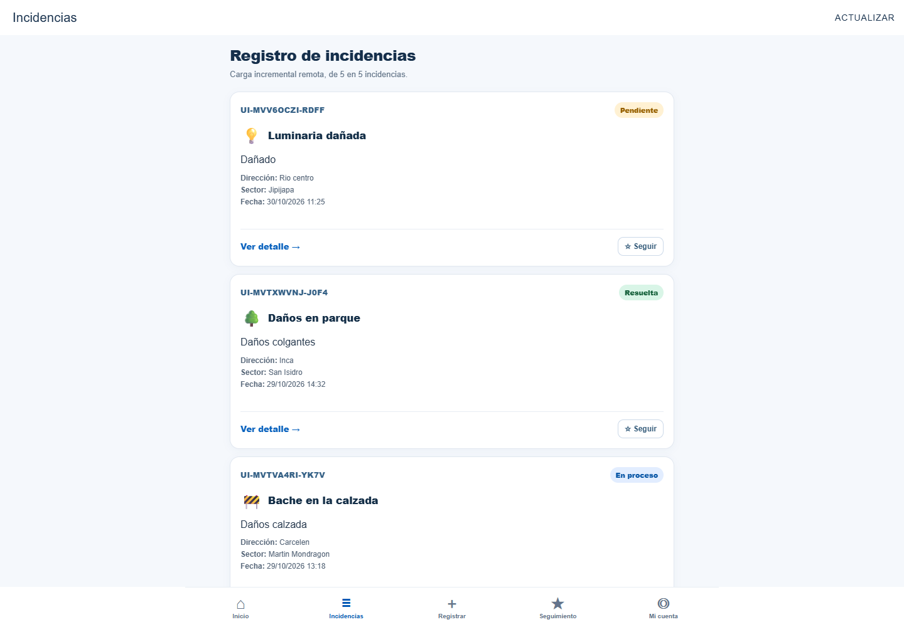 |

### Cuenta y validación del acceso

| Mi cuenta | Contraseña incorrecta |
|:---:|:---:|
| 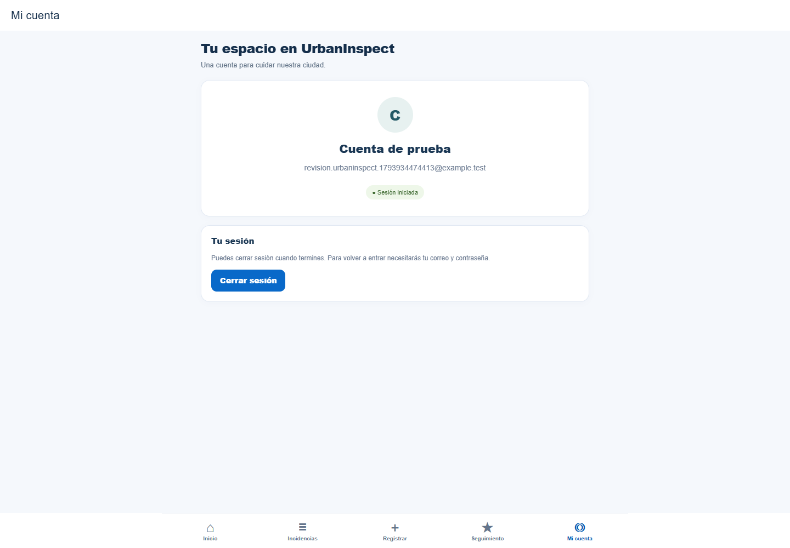 | 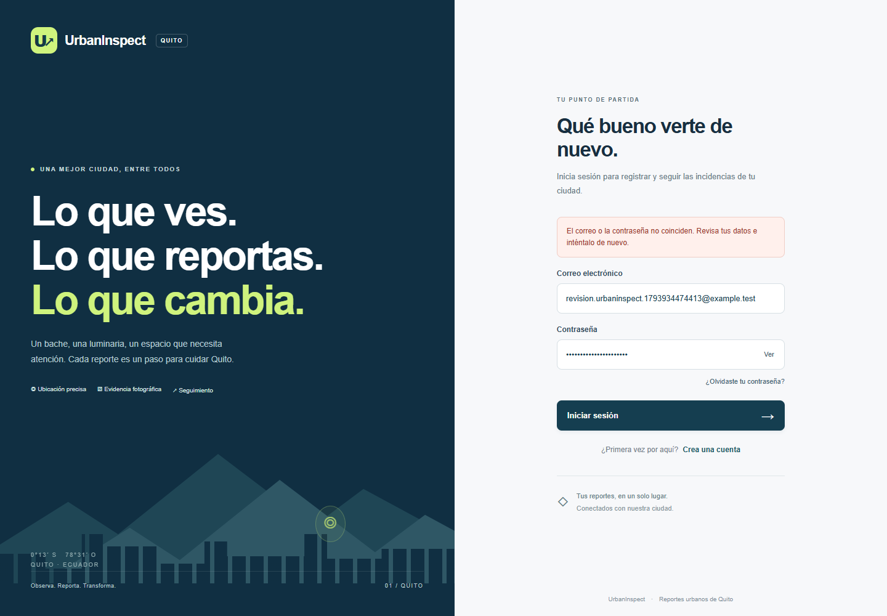 |

## Funciones de los reportes

Se pueden registrar baches, luminarias dañadas, problemas de señalización, alcantarillas obstruidas y daños en parques. Cada incidencia incluye descripción, dirección, sector, prioridad y estado.

El listado obtiene los registros de cinco en cinco. Desde el detalle se puede pasar de pendiente a en proceso o resuelta. Para resolver una incidencia se necesita una observación; una vez resuelta no puede retroceder de estado.

Las fotografías se envían a Cloudinary y se conserva su URL HTTPS. La prioridad alta exige una fotografía. Los baches requieren coordenadas válidas, que pueden obtenerse por GPS o escribirse manualmente. Open-Meteo permite consultar temperatura y precipitación antes del envío; si la precipitación supera 5 mm en una hora, la aplicación muestra una advertencia.

Los formularios incompletos y los casos marcados para seguimiento se guardan localmente. No se sincronizan entre dispositivos.

## Servicios utilizados

| Servicio | Uso |
|---|---|
| Firebase Hosting | Publicación de la aplicación web con HTTPS |
| Firebase Authentication | Registro, acceso, sesión y recuperación de contraseña |
| MockAPI | Consulta, creación y actualización de incidencias |
| Cloudinary | Almacenamiento de fotografías |
| Open-Meteo | Consulta de condiciones meteorológicas |
| Capacitor | Cámara, ubicación y almacenamiento en Android |

Firebase controla el acceso a las pantallas de la aplicación. El servicio de incidencias conserva MockAPI de la primera prueba: sus endpoints no validan tokens de Firebase ni aplican permisos por usuario. Los reportes son compartidos y se utilizan con fines académicos; no son reportes oficiales del Municipio de Quito.

## Ejecutar en el navegador

Se necesita Node.js compatible con Angular 22 y conexión a internet para los servicios externos. Esta entrega se comprobó con Node.js 24.

```bash
npm ci
npm start
```

La aplicación se abre en `http://localhost:4200`. Se puede crear una cuenta desde el formulario de registro. En el navegador se selecciona una fotografía del equipo; la cámara nativa se utiliza desde Android.

La configuración pública de Firebase está en `src/app/config/firebase.config.ts`. Las direcciones de MockAPI y Cloudinary están en `src/app/config/config.ts`. No se deben agregar contraseñas, claves privadas ni cuentas de servicio a esos archivos.

## Publicar en Firebase Hosting

```bash
npm run firebase:login
npm run deploy
```

La cuenta utilizada debe tener acceso al proyecto `urbaninspect-deploy`. Antes de publicar, el comando verifica la configuración de Firebase y genera la compilación de producción. Hosting publica la carpeta `www`; las rutas se redirigen a `index.html` para permitir abrir o recargar pantallas como `/incidencias` y `/cuenta`.

## Comprobaciones

```bash
npm run test:unit
npm run test:auth
npm run build
```

Se comprobaron 2 pruebas unitarias y 18 pruebas de acceso en Chrome, con vistas de celular y computadora. Las pruebas de acceso levantan el emulador oficial de Firebase Authentication con un proyecto de demostración y no crean usuarios en el proyecto publicado. Requieren Google Chrome instalado; las consultas de reportes se sustituyen durante esas pruebas para revisar el acceso de forma independiente.

También se revisó el sitio publicado con Firebase real: creación de una cuenta, inicio de sesión, recarga, consulta de reportes, contraseña incorrecta, cierre de sesión y bloqueo de una ruta privada. La cuenta temporal se eliminó al terminar.

## Preparar Android y generar el APK

Desde CMD, en la carpeta del proyecto:

```bat
cd /d C:\Proyectos\urbaninspect
npm run android:open
```

El comando compila la aplicación, copia los archivos actualizados a Android y abre Android Studio. También se puede ejecutar `npm run android:prepare` para compilar y sincronizar sin abrir el IDE.

En Android Studio, con la variante `debug`, seleccionar **Build → Generate Bundle(s) / APK(s) → Generate APK(s)**. Al terminar, la opción **Locate** permite encontrar el archivo:

```text
android/app/build/outputs/apk/debug/app-debug.apk
```

Este APK se puede copiar al celular para instalarlo. Se necesitan Android Studio, Android SDK y JDK configurados; la cámara y el GPS dependen de los permisos del dispositivo. La compilación del código y los recursos de Android se verificó con resultado `BUILD SUCCESSFUL` antes de generar el APK desde Android Studio.

## Capturas de las funciones de la primera prueba

Se conservan las capturas anteriores del registro de incidencias, fotografía, clima, seguimiento y recuperación de borradores.

| Inicio | Formulario | Fotografía |
|:---:|:---:|:---:|
|  | 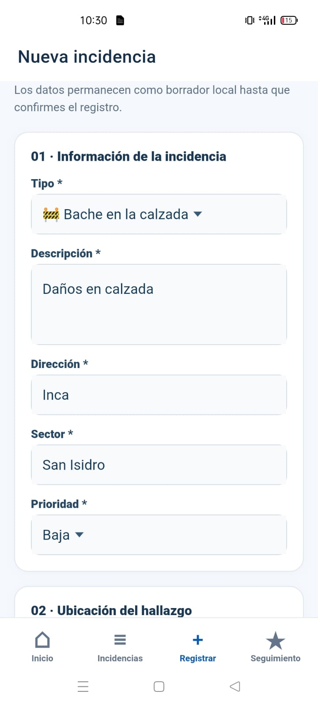 | 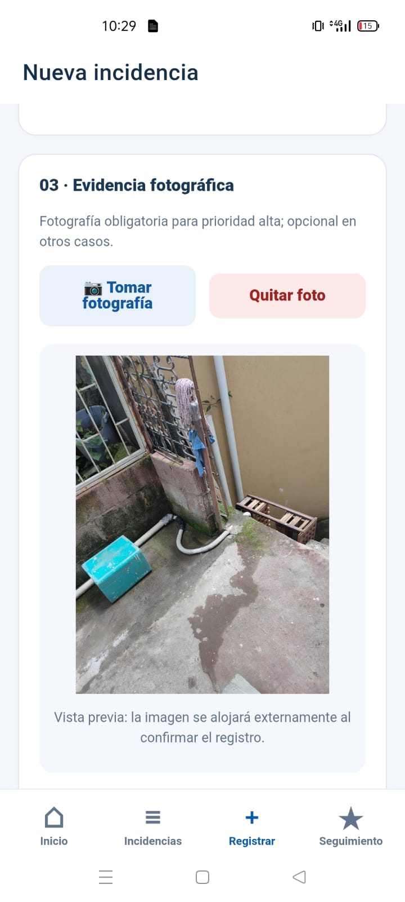 |

| Clima | Registro completado | Listado |
|:---:|:---:|:---:|
| 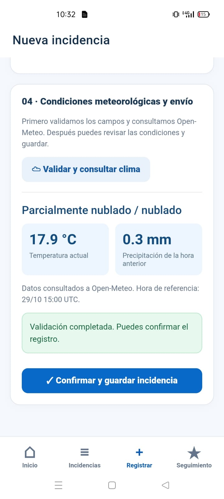 | 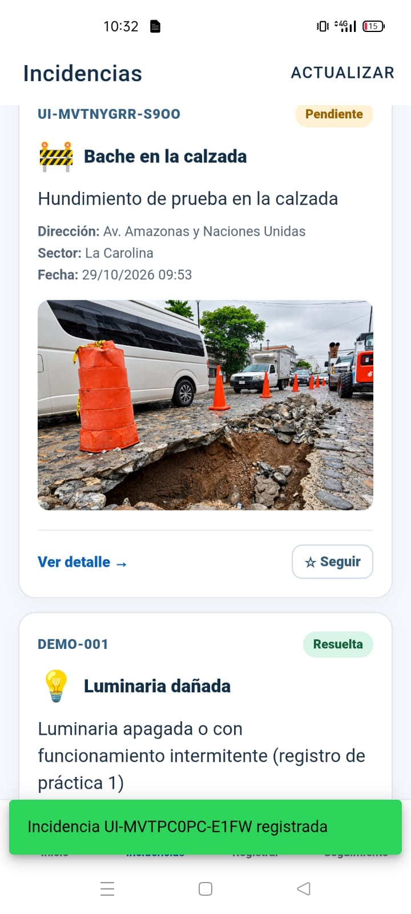 | 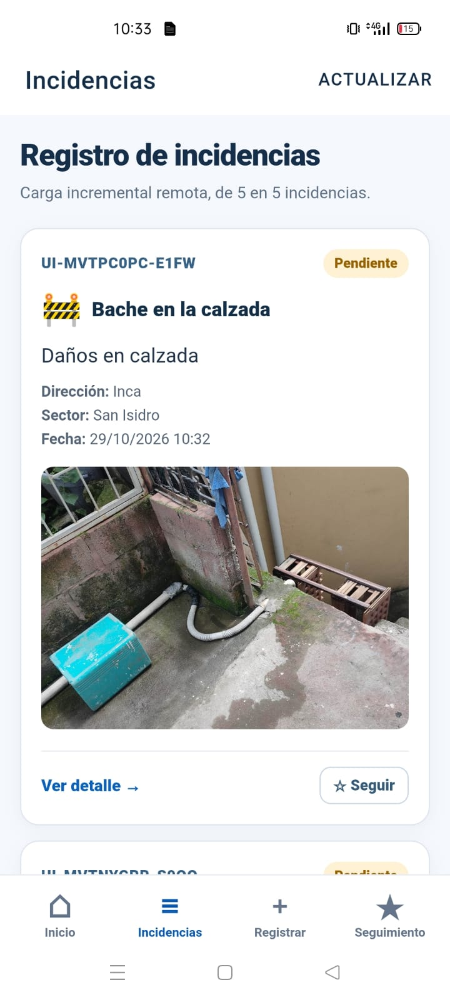 |

| Estado del reporte | Seguimiento | Borrador |
|:---:|:---:|:---:|
| 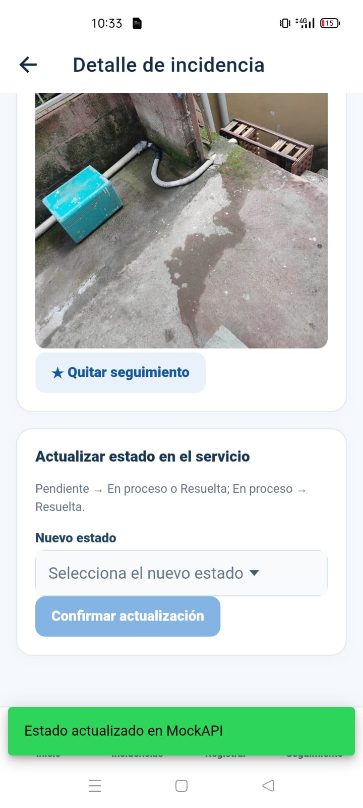 | 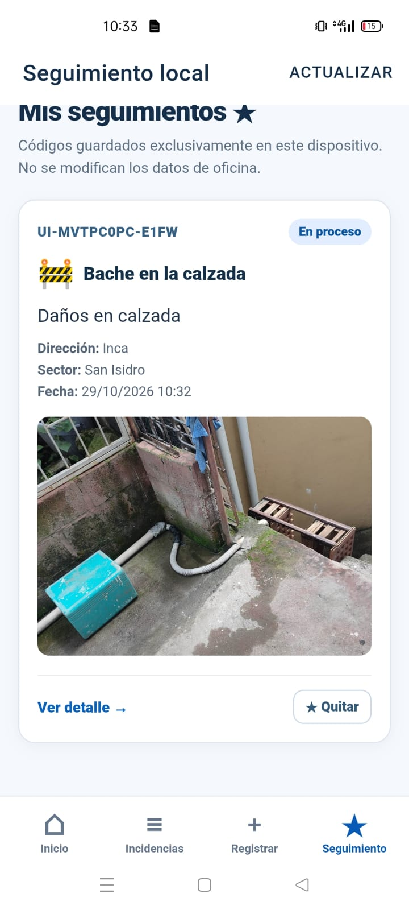 | 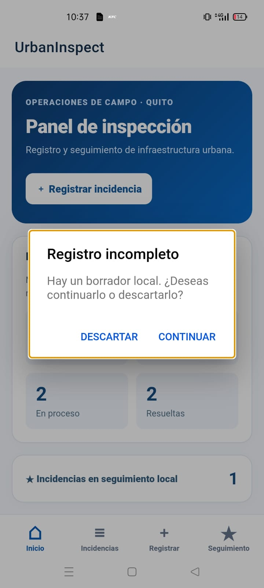 |

| Prioridad alta | Validación de ubicación | Evidencia en el listado |
|:---:|:---:|:---:|
| 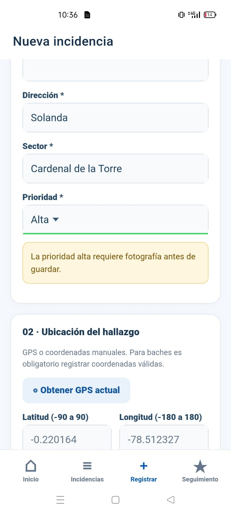 | 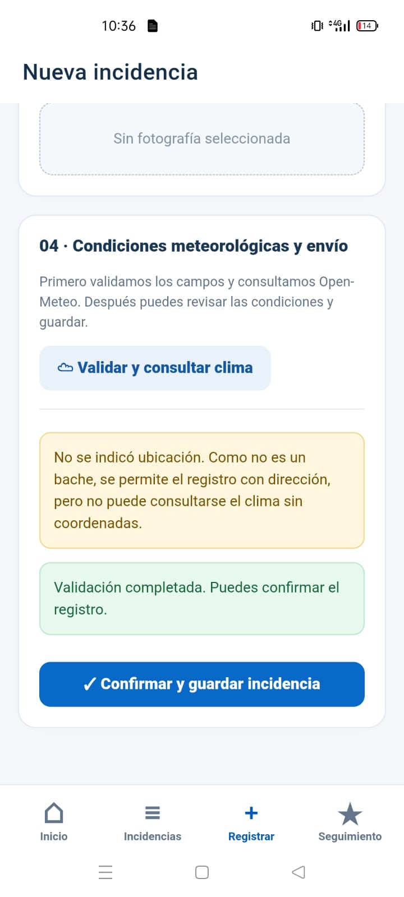 | 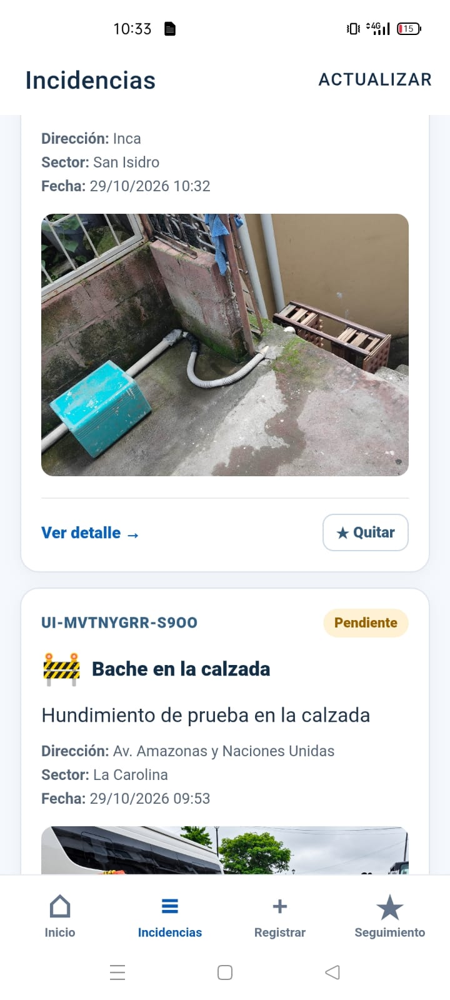 |
