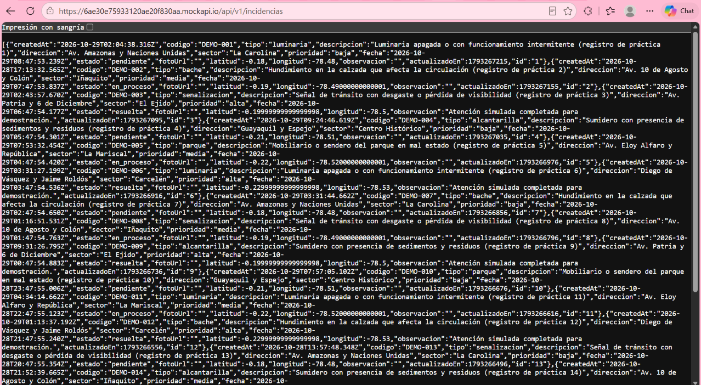
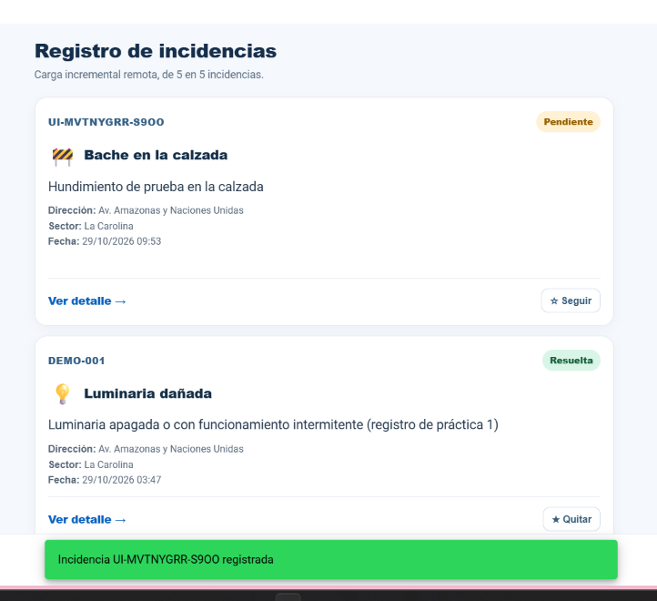
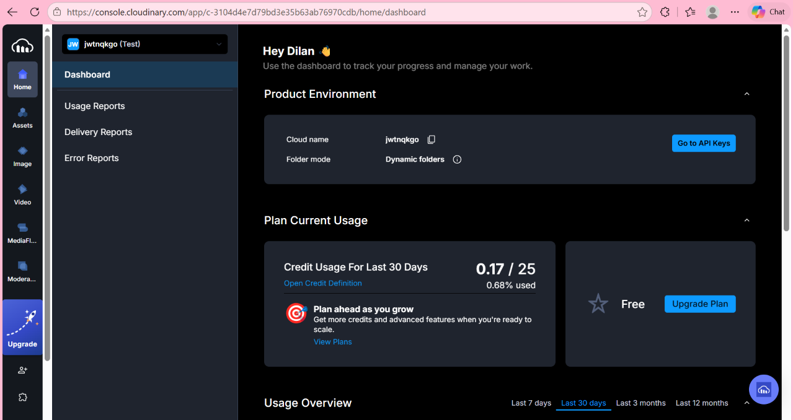
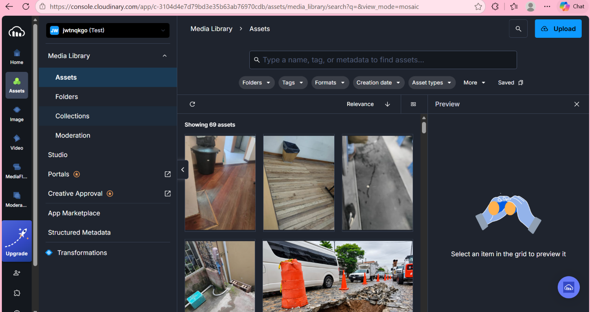

# UrbanInspect

**Registro y seguimiento de incidencias urbanas**

UrbanInspect es una aplicación para Android enfocada en reportar problemas de infraestructura urbana: baches, luminarias dañadas, señalización deteriorada, alcantarillas obstruidas y daños en parques. Permite registrar la ubicación, adjuntar evidencia fotográfica, consultar el clima y dar seguimiento a los casos.

El proyecto está desarrollado con **Ionic, Angular, TypeScript y Capacitor**. Utiliza **MockAPI** para las operaciones REST, **Cloudinary** para almacenar fotografías y **Open-Meteo** para las condiciones meteorológicas. Los registros marcados para seguimiento y los formularios incompletos se conservan localmente en el dispositivo.

## 1. Capturas de la aplicación Android

Las capturas corresponden a las pantallas principales de UrbanInspect y permiten revisar el flujo de registro, consulta y seguimiento de incidencias.

### Instalación y registro

| Pantalla de inicio | Formulario de incidencia | Fotografía tomada desde Android |
|:---:|:---:|:---:|
|  |  |  |

### Consulta meteorológica y registro remoto

| Condiciones meteorológicas | Confirmación de registro | Incidencia en listado |
|:---:|:---:|:---:|
|  |  |  |

### Detalle, seguimiento y recuperación

| Actualización de estado | Seguimiento local | Borrador recuperable |
|:---:|:---:|:---:|
|  |  |  |

### Validaciones y evidencia en el listado

| Prioridad alta | Ubicación no ingresada | Imagen del registro |
|:---:|:---:|:---:|
|  |  |  |

## 2. Funciones principales

- **Listado de incidencias:** consulta los datos del servidor de manera incremental, solicitando hasta cinco registros por página. Muestra tipo, descripción, dirección, sector, fecha, prioridad, estado y fotografía cuando existe.
- **Seguimiento local:** permite marcar y quitar incidencias; las marcas se almacenan en el teléfono, sin cambiar la información de MockAPI.
- **Registro de incidencias:** valida tipo, descripción, dirección, sector y prioridad. En prioridad alta exige una fotografía y para baches exige coordenadas válidas.
- **Cámara y fotografías:** en Android permite tomar una fotografía, revisarla y enviarla a Cloudinary. Se guarda la URL HTTPS en el registro remoto y la imagen puede consultarse después.
- **Ubicación:** obtiene coordenadas mediante GPS con permiso del usuario o permite escribirlas manualmente. Si no hay coordenadas y no se trata de un bache, puede registrarse el caso sin consulta meteorológica.
- **Clima:** consulta la temperatura, condición meteorológica y precipitación de la última hora a través de Open-Meteo. Si la precipitación supera 5 mm, presenta una advertencia sin bloquear automáticamente el registro.
- **Borradores:** guarda información incompleta localmente y ofrece las opciones **Continuar** y **Descartar** al recuperar el formulario.
- **Estados:** permite pasar de pendiente a en proceso o resuelta, y de en proceso a resuelta. Para resolver se necesita observación; una incidencia resuelta no puede retroceder a otro estado.

## 3. Herramientas y decisiones técnicas

| Tecnología | Uso en UrbanInspect |
|---|---|
| Ionic y Angular | Vistas, navegación, controles, formularios y eventos de la interfaz |
| TypeScript | Tipos de datos, validaciones, servicios y estados |
| Capacitor | Integración con Android y acceso a cámara, ubicación y almacenamiento |
| MockAPI | Operaciones REST de consulta, creación y actualización de incidencias |
| Cloudinary | Almacenamiento externo de imágenes y recuperación mediante URL |
| Open-Meteo | Condiciones meteorológicas para las coordenadas registradas |
| Capacitor Preferences | Seguimientos y datos del borrador en almacenamiento local |
| Capacitor Filesystem | Conservación local de la fotografía de un borrador |

Para la aplicación se utiliza MockAPI como servicio REST, con el propósito de gestionar la comunicación HTTP, la paginación y las actualizaciones remotas sin desarrollar un backend propio. El servicio no incorpora un sistema de autenticación de usuarios configurado en esta aplicación.

## 4. Requisitos para ejecutar

- Node.js y npm compatibles con la versión de Angular del proyecto.
- Ionic CLI instalado.
- Android Studio, Android SDK y JDK configurados para generar el APK.
- Conexión a internet para MockAPI, Cloudinary y Open-Meteo.

### Ejecutar en el navegador

Abrir CMD en la carpeta descargada del repositorio:

```cmd
npm ci
npm install -g @ionic/cli
ionic serve
```

La aplicación se abre normalmente en `http://localhost:8100`. Las funciones de GPS y cámara nativos se comprueban en Android; en el navegador se puede seleccionar una fotografía del equipo.

### Configurar los servicios

En `src/app/config/config.ts` se encuentran los valores públicos de conexión:

```typescript
export const CONFIG = {
  mockApiBaseUrl: 'https://TU_PROYECTO.mockapi.io/api/v1',
  cloudinaryCloudName: 'TU_CLOUD_NAME',
  cloudinaryUnsignedPreset: 'urbaninspect_unsigned',
  pageSize: 5,
} as const;
```

El bloque anterior ilustra la estructura de la configuración. Si se crea un nuevo entorno, se reemplazan los valores por los de ese entorno. No se añade `/incidencias` al final de `mockApiBaseUrl`, porque el servicio lo incorpora.

**MockAPI:** crear el recurso `incidencias` con los campos `codigo`, `tipo`, `descripcion`, `direccion`, `sector`, `prioridad`, `fecha`, `estado`, `fotoUrl`, `latitud`, `longitud`, `observacion` y `actualizadoEn`. El campo `id` lo genera el servicio. Para la paginación se utilizan `page` y `limit`.

**Cloudinary:** configurar un preset `urbaninspect_unsigned` de tipo *Unsigned* para la carga de fotografías. No colocar API Secret ni credenciales privadas en el frontend o el repositorio. **Open-Meteo** se consulta sin una clave privada en esta implementación.

### Datos y comprobación de servicios

Los scripts disponibles en `scripts/` permiten insertar registros y comprobar la respuesta del servicio:

```cmd
scripts\INSERTAR_18_DATOS.cmd
scripts\COMPROBAR_API.cmd
```

El primer comando agrega registros y no debe ejecutarse varias veces sobre el mismo recurso si no se desean duplicados.

## 5. Ejecutar en Android

Desde la raíz del proyecto:

```cmd
ionic build
npx cap sync android
npx cap open android
```

También se puede crear un APK de depuración desde CMD:

```cmd
cd android
gradlew.bat assembleDebug
```

Archivo generado:

```text
android/app/build/outputs/apk/debug/app-debug.apk
```

El nombre del APK puede cambiarse al copiar el archivo para la entrega; eso no modifica el identificador de la aplicación. Un APK de depuración permite instalar y revisar la aplicación; para distribuirla en una tienda se requiere generar y firmar una versión de publicación.

## 6. Organización del proyecto

```text
src/
  app/
    app.component.ts           Inicio general y detección de borrador
    app.routes.ts              Rutas de navegación
    config/config.ts           Direcciones de los servicios
    models/incidencia.ts       Interfaces y tipos de datos
    pages/
      inicio.page.ts           Panel principal
      incidencias.page.ts      Listado y carga incremental
      nuevo.page.ts            Formulario, cámara, GPS, clima y registro
      detalle.page.ts          Detalle y actualización de estados
      seguimiento.page.ts      Casos marcados localmente
    services/
      incidencias.service.ts   Solicitudes HTTP a MockAPI
      fotos.service.ts         Subida de imágenes a Cloudinary
      clima.service.ts         Consulta a Open-Meteo
      seguimiento.service.ts   Códigos guardados en Preferences
      borrador.service.ts      Borrador y foto local
    shared/
      navegacion.component.ts  Barra inferior
      tarjeta-incidencia.component.ts  Tarjetas de incidencias
android/                     Proyecto Android/Gradle
assets/                      Recursos fuente del icono y splash
scripts/                     Herramientas de verificación y datos
docs/capturas/               Capturas de las pantallas de la aplicación
```

Las rutas de la interfaz son `/inicio`, `/incidencias`, `/nuevo`, `/seguimiento` y `/detalle/:id`.

## 7. Verificación desde computadora

| Datos recibidos desde MockAPI | Comprobación del registro en la web |
|:---:|:---:|
|  |  |

La carga de cinco en cinco puede revisarse en la pestaña de red del navegador (`F12` → `Network` → `Fetch/XHR`) o usando `scripts\COMPROBAR_API.cmd`. Las consultas utilizan `page` y `limit`; los resultados no están precargados en una lista fija dentro del proyecto.

## 8. Alcance y observaciones

UrbanInspect permite registrar, consultar y actualizar incidencias urbanas desde Android, adjuntar fotografías, obtener coordenadas, consultar el clima y mantener seguimientos y borradores locales.

Las incidencias se almacenan en MockAPI y las fotografías se guardan en Cloudinary. El acceso al servicio REST está planteado para el entorno de trabajo de la aplicación, sin autenticación ni permisos diferenciados por usuario.

El uso de la cámara y del GPS depende de los permisos otorgados en Android. Las consultas a MockAPI, Cloudinary y Open-Meteo requieren conexión a internet y disponibilidad de estos servicios. La precipitación mostrada corresponde a la última hora consultada, por lo que puede diferir de las condiciones meteorológicas instantáneas.

## 9. Almacenamiento de fotografías con Cloudinary

UrbanInspect utiliza **Cloudinary** para almacenar las fotografías asociadas a las incidencias. Desde la aplicación se envía la imagen al servicio y se conserva la URL HTTPS devuelta, de manera que la evidencia pueda consultarse posteriormente desde el listado y el detalle de cada incidencia.

La conexión se mantiene organizada desde `src/app/config/config.ts`, mientras que el servicio `src/app/services/fotos.service.ts` se encarga de gestionar la carga de las imágenes. Las credenciales privadas no deben colocarse en el código del frontend.

### Panel de administración de Cloudinary

En el panel se puede consultar el entorno asociado al proyecto y revisar el uso general de los recursos.

<p align="center">
  
</p>

### Biblioteca multimedia

La biblioteca multimedia permite visualizar y organizar los archivos almacenados en Cloudinary, incluidas las fotografías utilizadas como evidencia de las incidencias.

<p align="center">
  
</p>

## 10. Ajustes de presentación visual

La actualización de esta versión se concentra en la **presentación visual y la usabilidad de la aplicación**, ya que la estructura funcional del sistema se encontraba implementada. Se prioriza una apariencia más uniforme y ordenada mediante:

- Uso consistente de colores, fondos y contrastes.
- Mejor jerarquía visual en títulos, subtítulos e indicadores.
- Organización de tarjetas y bloques de información.
- Ajustes de espaciado, alineación y distribución de los elementos.
- Presentación más clara de formularios, botones y estados de las incidencias.
- Mayor consistencia entre las pantallas y la navegación.

Se conserva el funcionamiento existente: registro, consulta y actualización de incidencias, comunicación con MockAPI, almacenamiento de fotografías en Cloudinary, ubicación, consulta meteorológica y almacenamiento local. El alcance de esta actualización no consiste en rehacer esos procesos, sino en mejorar la forma en que la información y las acciones se presentan al usuario.

## 11. Organización de la actualización

Los cambios de presentación visual se mantienen en una rama independiente denominada `mejora-visual-urbaninspect`, creada a partir de `main`. De esta manera, `main` conserva la versión original del proyecto y las mejoras quedan separadas para su revisión, sin reemplazar la versión inicial.
